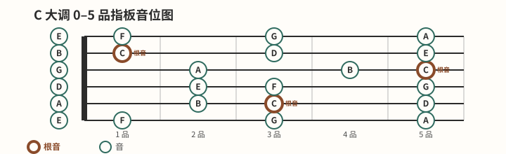

# 学习路线总览

## 适用对象

这条路线面向三类读者：第一次接触吉他的零基础学习者；想重新检查持琴、按弦与拨弦起点的重建者；以及只需查某个主题、但希望知道它在整体路线中位置的读者。

## 导航方法

路线只组织阶段顺序和先修关系，不重复各课正文。零基础读者从第 1 项开始；已有基础者可从自测选入口。进入任何一课后，若自检不稳定，就沿“先修知识”回退一页处理具体问题，再回到原课复查。

当前只有第 1、2 模块的目标页已经发布。后续模块保留为纯文字说明，等各自撰写批次完成并通过链接检查后才会变为真实链接。

### 三类图示预览

[打开原图（移动端可放大）](../assets/diagrams/fretboard-c-major-scale.svg)

[打开原图（移动端可放大）](../assets/diagrams/rhythm-basic-eighth-strum.svg)

## 有序链接

1. 从这里开始：先做 [[00-从这里开始/开始前自测|开始前自测]]，再用 [[00-从这里开始/吉他调音与标准音|吉他调音与标准音]] 建立可复查的声音起点。
2. 持琴与基础动作：从 [[01-持琴与基础动作/认识民谣吉他|认识民谣吉他]] 进入，依次建立支撑、按弦、拨弦和换弦控制。
3. 和弦系统：从 [[02-和弦系统/和弦图读法|和弦图读法]] 进入，学习开放和弦、转换、常用进行与横按。
4. 节奏系统：从 [[03-节奏系统/节拍拍号与小节|节拍拍号与小节]] 开始，学习拍号、音符时值、节拍器、扫弦与切分。
5. 演奏技巧：从 [[04-演奏技巧/分解和弦基础|分解和弦基础]] 开始，学习分解和弦、制音、击弦、勾弦、滑音等表达手段。
6. 弹唱与伴奏：从 [[05-弹唱与伴奏/根据人声选择调|根据人声选择调]] 开始，学习选调、变调夹、弹唱协调、段落组织与基础编配。
7. 基础乐理与指板：从 [[06-基础乐理与指板/音高音名与唱名|音高音名与唱名]] 进入，连接音名、指板、音程、音阶、调号、三和弦与级数。
8. 练习与复盘：从 [[07-练习与复盘/有效练习流程|有效练习流程]] 进入，建立节拍器、速度、日志、错误修正与阶段测验闭环。
9. 保养、安全与排错：从 [[08-保养安全与排错/疼痛疲劳与停止练习边界|疼痛疲劳与停止练习边界]] 进入，区分停止练习、可逆排查、基础换弦与需要专业人士处理的边界。
10. 术语与参考资料：将提供术语、和弦、节奏索引与可追溯来源；真实链接将在该模块撰写批次加入。

## 完成标准

你能从目前存在的链接中选择一个真实起点，并说明遇到困难时应回查的上一层内容。选择后，下一步是在该页完成至少一项练习和对应自检，而不是仅浏览模块名称。

## 更新策略

后续每个内容批次只在目标页面真实存在并通过校验后，把所属模块的纯文字说明改为链接。任何改序都要同步检查先修关系、返回路径和移动端图示；预览图继续由生成器维护，不手工改写 SVG。
