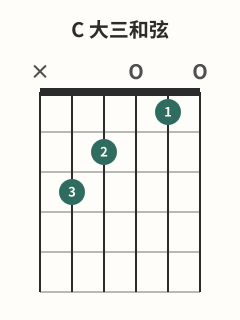

# 和弦图读法

## 学习目标与先修知识

先完成 [[01-持琴与基础动作/08-相邻弦与跨弦|相邻弦与跨弦]]，确认你能按 6 至 1 的弦号定位。本页目标是认出琴弦、品格、上弦枕、圆点、指号以及 X/O 标记，并把一张图准确转写成六弦到一弦的 tuple。

## 核心概念

本库与常见的正面和弦图把琴颈想成正对读者：六条竖线从左至右对应第 6 弦到第 1 弦；横线分出品格，顶端粗线是上弦枕。上方 X 表示该弦不弹或制音，O 表示空弦；格内圆点是按弦位置，1–4 是手指号而不是品号。[^chart-fender]

和弦图编码的是一个具体 voicing（按法/配置），不是该和弦唯一的指法或手型。本库把六弦写在 tuple 最左边，一弦写在最右边。

## 图示与操作步骤

本页所有指法数字均按低音六弦到高音一弦书写；`x` 表示不弹/制音，`0` 表示空弦。

[打开C 大三和弦原图（移动端可放大）](../assets/diagrams/chord-c-major.svg)

C 图读作 `x-3-2-0-1-0`：第 6 弦不弹；第 5 弦3 品用 3 指；第 4 弦2 品用 2 指；第 3 弦空弦；第 2 弦1 品用 1 指；第 1 弦空弦。这些位置是本批采用的 C 开放按法。[^c-fender]

读任意图时，从低音六弦向高音一弦扫描，跳过开头的 `x`；第一个允许发声的位置就是起始弦，可以是 `0`，也可以是正品位数字。先确认起始弦，再逐弦说 X/O/品位，最后才对照指号。C `x-3-2-0-1-0` 从第 5 弦 3 品起；G `3-2-0-0-3-3` 从第 6 弦 3 品起；完整 F `1-3-3-2-1-1` 从第 6 弦 1 品起。这三个例子只核对起始弦，不要求现在学习后两种手型。

## 常见错误及修正

| 现象                      | 原因                         | 修正                                                       |
| ------------------------- | ---------------------------- | ---------------------------------------------------------- |
| 把 tuple 从 1 弦读到 6 弦 | 把图的左右与手上视角混在一起 | 先指左侧竖线并说“6 弦”                                     |
| 把横线当成按弦位置        | 没有区分品丝和品格           | 圆点放在两条品丝之间的格内                                 |
| 把 X 当空弦               | 只看到“没有圆点”             | 逐一口述：X 不弹，O 才是空弦                               |
| 把指号当品号              | 跳过圆点所在品格             | 先读品格，再读圆点内的手指号                               |
| 忽略起始弦                | 只记手型                     | 从低音六弦向高音一弦跳过开头的 `x`，找第一个允许发声的位置 |

## 分级练习

### 入门｜符号识别

遮住圆点，只指出六弦、一弦、上弦枕、X 与 O；再遮住顶部，说出圆点的品位和指号。

### 巩固｜图转 tuple

不看正文解码 C 图，写出六个位置；再与 `x-3-2-0-1-0` 逐项比对，标记是弦序还是符号出错。

### 挑战｜tuple 转口述

只看 `x-3-2-0-1-0`，从六弦开始说出每根弦的动作和采用指号，然后在图上反向核对。

## 自我检查标准

- 你能在不倒转弦序的情况下，完整读出 `x-3-2-0-1-0`。
- 你会把 X 说成不弹/制音，把 O 或 `0` 说成空弦。
- 你能分开说明“第几品”与“第几指”，并且先确认起始弦。

## 下一步与相关词条

下一步进入 [[02-和弦系统/02-Em与E和弦|Em与E和弦]]。弦号不稳时回到 [[01-持琴与基础动作/08-相邻弦与跨弦|相邻弦与跨弦]]；准备实际落指时可查 [[01-持琴与基础动作/05-正确按弦|正确按弦]]。

## 参考来源与延伸阅读

下列资料用于核对读图符号与 C 指位；本页读图练习为原创。

[^chart-fender]: [How to Read a Chord Chart](https://www.fender.com/articles/chords/how-to-read-a-chord-chart) — Fender Musical Instruments Corporation；访问日期：2026-10-01。

[^c-fender]: [Learn to Play the C Chord on Guitar](https://www.fender.com/articles/chords/learn-how-to-play-c-guitar-chord) — Fender Musical Instruments Corporation；访问日期：2026-10-01。
