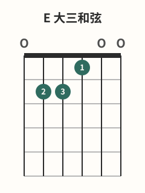

# Em与E和弦

## 学习目标与先修知识

先完成 [[02-和弦系统/01-和弦图读法|和弦图读法]]。本页要分别组成 Em 与 E，对照两者在第 3 弦的差异，并从六弦开始逐弦验音。

> 安全边界：本页不用于诊断或治疗。出现疼痛、麻木或针刺感、无力、肿胀、动作控制下降或明显不适时，立即停止；症状持续、反复或加重时，请向合格医疗专业人士求助。[^safety-bapam]

## 核心概念

本批采用的 Em 是 `0-2-2-0-0-0`，E 是 `0-2-2-1-0-0`。[^em-fender][^e-fender] 两者都从六弦起奏；E 在第 3 弦1 品加入 G#，Em 则保留第 3 弦空弦 G。图中指号是本页采用的一种分配，不是唯一解。

## 图示与操作步骤

本页所有指法数字均按低音六弦到高音一弦书写；`x` 表示不弹/制音，`0` 表示空弦。

[打开E 小三和弦原图（移动端可放大）](../assets/diagrams/chord-e-minor.svg)

Em `0-2-2-0-0-0`：第 5 弦2 品用 2 指，第 4 弦2 品用 3 指，其余都是空弦。放好两指后从六弦到一弦逐根拨。[^em-fender]

[打开E 大三和弦原图（移动端可放大）](../assets/diagrams/chord-e-major.svg)

E `0-2-2-1-0-0`：保留第 5 弦2 品的 2 指与第 4 弦2 品的 3 指，再用 1 指按第 3 弦1 品。[^e-fender] 每次先慢慢组形，再逐弦检查，不用速度掩盖闷音。

## 常见错误及修正

- Em 不小心按住第 3 弦，或 E 忘了第 3 弦1 品：单独拨第 3 弦，核对 G/G# 状态。
- 手指侧面碰到高音空弦：先改变接触点，让相邻弦有空间。[^fretting-fender]
- 为了“更响”不断加压：右手决定拨弦力度，左手只需稳定发声的最小有效压力。[^dynamics-fender]
- 一根弦长期杂音就认定是手指力量不足：先检查是否靠近目标品丝，也考虑琴弦或 setup 因素。[^fretting-fender]

## 分级练习

### 入门｜分别组形

先不给节拍压力，分别组成 Em 和 E；每次都从六弦逐根检查，记下第一根不清晰的弦。

### 巩固｜一指差异

保留第 5、4 弦两指，让第 3 弦在空弦与 1 品之间切换。每次都先听第 3 弦，再扫六根弦。

### 挑战｜原创 Em↔E 循环

用整和弦单次拨奏轮换 `Em→E→Em→E`。先在每次转换间停顿确认，只在落指稳定后才用舒适且稳定的脉冲连接。

## 自我检查标准

- 你能说出 Em 第 3 弦是空弦，E 第 3 弦是 1 品。
- 两个指法的六根目标弦都能分别听见；听到杂音时能定位到具体弦。
- 自检不把忍受症状当成通过条件；出现不适即停止。

## 下一步与相关词条

下一步学习 [[02-和弦系统/03-Am与A和弦|Am与A和弦]]。读图混乱时回到 [[02-和弦系统/01-和弦图读法|和弦图读法]]；杂音难以定位时查 [[01-持琴与基础动作/05-正确按弦|正确按弦]]。

## 参考来源与延伸阅读

指位、最小有效压力与安全边界依据下列资料；循环为本页原创。

[^em-fender]: [How to Play an Em Guitar Chord](https://www.fender.com/articles/chords/learn-how-to-play-e-minor-chord) — Fender Musical Instruments Corporation；访问日期：2026-10-01。

[^e-fender]: [How to Play the E Chord on Guitar](https://www.fender.com/articles/chords/learn-how-to-play-the-e-major-chord-on-guitar) — Fender Musical Instruments Corporation；访问日期：2026-10-01。

[^fretting-fender]: [5 Ways to Cut the Buzz](https://www.fender.com/articles/techniques/5-ways-to-stop-fret-buzz) — Fender Musical Instruments Corporation；访问日期：2026-10-01。

[^dynamics-fender]: [How to Use Dynamics to Improve Your Guitar Playing](https://www.fender.com/articles/techniques/how-to-use-dynamics-to-improve-guitar-playing) — Fender Musical Instruments Corporation；访问日期：2026-10-01。

[^safety-bapam]: [Returning to Playing and Performance for Instrumental Musicians](https://www.bapam.org.uk/return-to-play/) — British Association for Performing Arts Medicine；访问日期：2026-10-01。
