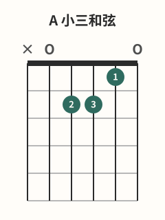
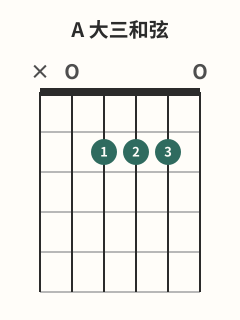

# Am与A和弦

## 学习目标与先修知识

先完成 [[02-和弦系统/02-Em与E和弦|Em与E和弦]]。本页要分别组成 Am 与 A，从五弦准确起奏，并核对第 2 弦的 1/2 品差异。

> 安全边界：本页不用于诊断或治疗。出现疼痛、麻木或针刺感、无力、肿胀、动作控制下降或明显不适时，立即停止；症状持续、反复或加重时，请向合格医疗专业人士求助。[^safety-bapam]

## 核心概念

Am 为 `x-0-2-2-1-0`，A 为 `x-0-2-2-2-0`，两者都从第 5 弦起奏，第 6 弦在本批 voicing 中不弹。[^am-fender][^a-fender] 两形的音高差集中在第 2 弦：Am 是 1 品 C，A 是 2 品 C#。

图中 A 的 1、2、3 指分配只是一种可行的指法选项，不是所有手型和琴颈都必须照搬的唯一规则。[^a-fender]

## 图示与操作步骤

本页所有指法数字均按低音六弦到高音一弦书写；`x` 表示不弹/制音，`0` 表示空弦。

[打开A 小三和弦原图（移动端可放大）](../assets/diagrams/chord-a-minor.svg)

Am `x-0-2-2-1-0`：第 4 弦2 品用 2 指，第 3 弦2 品用 3 指，第 2 弦1 品用 1 指；第 5、1 弦为空弦。[^am-fender]

[打开A 大三和弦原图（移动端可放大）](../assets/diagrams/chord-a-major.svg)

A `x-0-2-2-2-0`：本图依次用 1、2、3 指按第 4、3、2 弦2 品，第 5、1 弦为空弦。[^a-fender] 先安置手指，再从第 5 弦逐弦检查；没有要求三指第一次就同时落下。

## 常见错误及修正

- 把第 6 弦当成起始弦：在拨奏前先触指第 5 弦，并口述“从五弦开始”。
- 按弦手碰闷第 1 弦或其他相邻弦：靠近目标品丝并调整指尖接触点。[^fretting-fender]
- 把 A 的三指排列当成不可变的通用手型：先以图中选项完成对照，不宣称它是唯一方案。
- 声音不大就加大左手压力：用最小有效压力保持清晰，音量由拨弦动态调整。[^dynamics-fender]

## 分级练习

### 入门｜单独检查

分别组成 Am 和 A，从五弦到一弦逐根拨；只记录哪根弦发生闷音或杂音。

### 巩固｜Am↔A 对照

在每次改变后单独拨第 2 弦，确认 Am 为 1 品、A 为 2 品；再听完整的五弦 voicing。

### 挑战｜原创成对循环

以 `Am→A→A→Am` 作为原创练习顺序。先允许停顿检查，稳定后再用舒适脉冲连接，不设固定速度。

## 自我检查标准

- 你能准确排除第 6 弦，从第 5 弦启动两个指法。
- 你能说明 Am 与 A 的第 2 弦分别是 1 品和 2 品。
- 你能逐弦找到误触点，而不会用“所有人必须如此”来描述 A 的指号。

## 下一步与相关词条

下一步进入 [[02-和弦系统/04-C和弦|C和弦]]。比较前一组开放和弦时回到 [[02-和弦系统/02-Em与E和弦|Em与E和弦]]；排查按弦接触时查 [[01-持琴与基础动作/05-正确按弦|正确按弦]]。

## 参考来源与延伸阅读

指位和起始弦由下列和弦资料核对；所有循环为原创。

[^am-fender]: [How to Play the A Minor Chord](https://www.fender.com/articles/chords/learn-how-to-play-a-minor-guitar-chord) — Fender Musical Instruments Corporation；访问日期：2026-10-01。

[^a-fender]: [How to Play the A Chord on Guitar](https://www.fender.com/articles/chords/learn-to-play-the-a-chord-on-guitar) — Fender Musical Instruments Corporation；访问日期：2026-10-01。

[^fretting-fender]: [5 Ways to Cut the Buzz](https://www.fender.com/articles/techniques/5-ways-to-stop-fret-buzz) — Fender Musical Instruments Corporation；访问日期：2026-10-01。

[^dynamics-fender]: [How to Use Dynamics to Improve Your Guitar Playing](https://www.fender.com/articles/techniques/how-to-use-dynamics-to-improve-guitar-playing) — Fender Musical Instruments Corporation；访问日期：2026-10-01。

[^safety-bapam]: [Returning to Playing and Performance for Instrumental Musicians](https://www.bapam.org.uk/return-to-play/) — British Association for Performing Arts Medicine；访问日期：2026-10-01。
