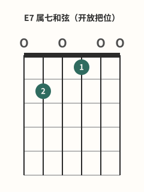
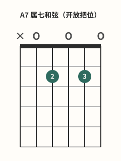
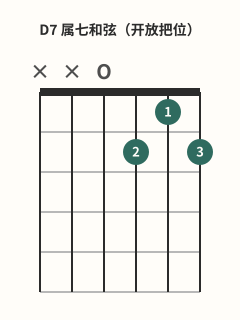

# 常用七和弦

## 学习目标与先修知识

先完成 [[02-和弦系统/06-D与Dm和弦|D与Dm和弦]]。本页只介绍 E7、A7、D7 三个开放属七和弦形，不代表全部七和弦类型。目标是记住各自 tuple、起始弦与四音音类集合。

> 安全边界：本页不用于诊断或治疗。出现疼痛、麻木或针刺感、无力、肿胀、动作控制下降或明显不适时，立即停止；症状持续、反复或加重时，请向合格医疗专业人士求助。[^safety-bapam]

## 核心概念

本页的“7”指 dominant seventh（属七）质地。E7、A7、D7 各自由四个音类组成，但不能因为都有“7”就把所有七和弦当成同一类。

可以先会按法，再补理论：这些形都保留大三和弦的根、三、五，并加入距根音10半音的小七度。例如E大三和弦E G♯ B加入D，而不是距E有11半音的D♯。前者为E7，后者为Emaj7。名称里的“属七”首先描述这里的音程结构，是否在某段音乐担当属功能还要看上下文。完整分类见 [[06-基础乐理与指板/16-七和弦构成|七和弦构成]]，不要求将该理论课作为本页先修。[^sevenths-current]

## 图示与操作步骤

本页所有指法数字均按低音六弦到高音一弦书写；`x` 表示不弹/制音，`0` 表示空弦。

[打开E7 属七和弦原图（移动端可放大）](../assets/diagrams/chord-e7-open.svg)

E7 `0-2-0-1-0-0`：2 指按第 5 弦2 品，1 指按第 3 弦1 品，六弦全弹；音类集合 E–G#–B–D。[^e7-fender]

[打开A7 属七和弦原图（移动端可放大）](../assets/diagrams/chord-a7-open.svg)

A7 `x-0-2-0-2-0`：本图采用 2 指按第 4 弦2 品、3 指按第 2 弦2 品，从五弦起奏；音类集合 A–C#–E–G。指号是一种采用方案，不是通用唯一规则。[^a7-fender]

[打开D7 属七和弦原图（移动端可放大）](../assets/diagrams/chord-d7-open.svg)

D7 `x-x-0-2-1-2`：2 指按第 3 弦2 品，1 指按第 2 弦1 品，3 指按第 1 弦2 品，从四弦起奏；音类集合 D–F#–A–C。[^d7-fender]

### 逐弦实响核对

表中按6→1弦写位置和实响，省略不发声的弦；没有变调夹。

| 和弦 | 六到一弦    | 实响音高           |
| ---- | ----------- | ------------------ |
| E7   | 0-2-0-1-0-0 | E2 B2 D3 G♯3 B3 E4 |
| A7   | x-0-2-0-2-0 | A2 E3 G3 C♯4 E4    |
| D7   | x-x-0-2-1-2 | D3 A3 C4 F♯4       |

E7中E与B重复，A7中E重复，D7此形四种音各一次。它们的七音分别是4弦空弦D3、3弦空弦G3、2弦1品C4；被邻指碰哑时，外形可能仍像七和弦，实际却可能失去决定“7”的音。逐弦检查要说出这根弦负责什么，而非只问“整体好像响了没有”。

### 与对应大三和弦逐步比较

E的 `0-2-2-1-0-0` 中4弦E3改为E7的D3（2品→空弦）；A的 `x-0-2-2-2-0` 中3弦A3改为G3；D的 `x-x-0-2-3-2` 中2弦D4改为C4。三者都将一个重复根音降低全音变成小七音，其余位置保留，所以并不是“所有音都降低”。换到其他配置时不保证只动同一手指，这只是本页三个形的比较办法。

## 常见错误及修正

- 把每个带“7”的和弦都当成同一质地：本页明确只处理三个开放属七形。
- 三个和弦使用同一起始弦：分别口述 E7 从六弦、A7 从五弦、D7 从四弦开始。
- 把 A7 的采用指号当成唯一方案：对照本 SVG 时使用 2/3 指，同时保留“还有其他可行指法”的边界。
- 杂音出现就加压：先检查品丝后方的接触与 setup，只用最小有效压力。[^fretting-fender][^dynamics-fender]

## 分级练习

### 一级：辨认

R1. E7、A7、D7各从哪根弦起？哪个实际音负责七音？它们为何不是maj7？

### 二级：推导

D1. 把E、A、D三个大三和弦变成本页七和弦，逐一写变动的弦、原实响与新实响，说明相对根音的距离。

### 三级：应用

A1. 原创E7→A7→D7循环，每和弦一小节4/4、每拍一次下拨。先逐弦后整和弦，记录七音是否被碰哑与起始弦是否正确；若D7的2弦不响，分析剩余音。该循环是转换练习，不代表特定调的完整终止进行。

### 答案与解析

- R1：分别6/5/4弦起；七音D3/G3/C4。它们距根音对应的小七度为10半音，而maj7要求大七度11半音。
- D1：E的4弦E3→D3，A的3弦A3→G3，D的2弦D4→C4，均从重复根音下降全音；折算相对根音音级距离为10半音，其余音保持。
- A1：D7失去C4后剩D3 A3 F♯4，仅表达D大三音集合。记录应包含具体弦与原因；七音清楚、4拍不丢、无误触低弦才算本轮通过。先检查碰弦、接触位置与用力，不能为补响而忍痛加压；没有实弹时只完成分析，不填写听辨已通过。

## 自我检查标准

- E7：`0-2-0-1-0-0`，六弦起，E–G#–B–D。
- A7：`x-0-2-0-2-0`，五弦起，A–C#–E–G。
- D7：`x-x-0-2-1-2`，四弦起，D–F#–A–C。
- 你能逐弦核对三个 voicing，而不会用指号的一种选择代表所有演奏法。

## 下一步与相关词条

下一步进入 [[02-和弦系统/08-和弦转换方法|和弦转换方法]]。相关开放形可回查 [[02-和弦系统/06-D与Dm和弦|D与Dm和弦]]、[[02-和弦系统/02-Em与E和弦|Em与E和弦]] 与 [[02-和弦系统/03-Am与A和弦|Am与A和弦]]。

## 参考来源与延伸阅读

三个 voicing 与一般按弦原则由下列资料支持；循环为原创。

[^e7-fender]: [How to Play the E7 Chord on Guitar](https://www.fender.com/articles/chords/learn-how-to-play-e7-guitar-chord) — Fender Musical Instruments Corporation；访问日期：2026-10-01。

[^a7-fender]: [How to Play an A7 Chord on Guitar](https://www.fender.com/articles/chords/learn-how-to-play-a7-guitar-chord) — Fender Musical Instruments Corporation；访问日期：2026-10-01。

[^d7-fender]: [How to Play a D7 Guitar Chord](https://www.fender.com/articles/chords/learn-how-to-play-d7-guitar-chord) — Fender Musical Instruments Corporation；访问日期：2026-10-01。

[^fretting-fender]: [5 Ways to Cut the Buzz](https://www.fender.com/articles/techniques/5-ways-to-stop-fret-buzz) — Fender Musical Instruments Corporation；访问日期：2026-10-01。

[^dynamics-fender]: [How to Use Dynamics to Improve Your Guitar Playing](https://www.fender.com/articles/techniques/how-to-use-dynamics-to-improve-guitar-playing) — Fender Musical Instruments Corporation；访问日期：2026-10-01。

[^safety-bapam]: [Returning to Playing and Performance for Instrumental Musicians](https://www.bapam.org.uk/return-to-play/) — British Association for Performing Arts Medicine；访问日期：2026-10-01。

[^sevenths-current]: [Introduction to Seventh Chords](https://musictheory.pugetsound.edu/mt21c/SeventhChordsIntroduction.html) — Robert Hutchinson，Music Theory for the 21st-Century Classroom，University of Puget Sound；访问日期：2026-10-02。用于七和弦分类及大三和弦加小七度的结构；实际弦品由本站核算。
