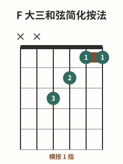
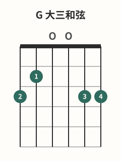

# C-Am-F-G和弦进行

## 学习目标与先修知识

先完成 [[02-和弦系统/C-G-Am-Em和弦进行|C-G-Am-Em和弦进行]]。本页是自包含的简化 F 入门：会在正文中完整解释指位，不把后一页当成先修。`C→Am→F→G` 是本库原创教学循环，不来自歌曲，不复制扫弦型、TAB 或歌词。

> 安全边界：本页不用于诊断或治疗。出现疼痛、麻木或针刺感、无力、肿胀、动作控制下降或明显不适时，立即停止；症状持续、反复或加重时，请向合格医疗专业人士求助。[^safety-bapam]

## 核心概念

简化 F 的 `x-x-3-2-1-1` 是 F 大三和弦，发声音类为 F–A–C，从第 4 弦起奏。[^f-fender] 食指在1 品覆盖第 1–2 弦的两弦小横按只是一种实现；本页要在无痛、无症状前提下逐弦验证，而不用更大压力追速度。[^dynamics-fender]

## 图示与操作步骤

本页所有指法数字均按低音六弦到高音一弦书写；`x` 表示不弹/制音，`0` 表示空弦。

[打开C 大三和弦原图（移动端可放大）](../assets/diagrams/chord-c-major.svg)

C 是 `x-3-2-0-1-0`，从第 5 弦起奏。[^c-fender]

[打开A 小三和弦原图（移动端可放大）](../assets/diagrams/chord-a-minor.svg)

Am 是 `x-0-2-2-1-0`，从第 5 弦起奏。[^am-fender]

[打开F 大三和弦简化按法原图（移动端可放大）](../assets/diagrams/chord-f-major-simplified.svg)

F 是 `x-x-3-2-1-1`：3 指按第 4 弦3 品，2 指按第 3 弦2 品，1 指在第 1 品同时覆盖第 2、1 弦；第 6、5 弦不弹。[^f-fender]

[打开G 大三和弦四指变体原图（移动端可放大）](../assets/diagrams/chord-g-major.svg)

G 是本批四指变体 `3-2-0-0-3-3`，六弦全弹。[^g-fender]

先在无症状前提下单独验证简化 F，再练 C→Am、Am→F、F→G、G→C，最后才连成循环。落指可分步建立，不要求初次就全部同时到位。[^changes-fender]

## 常见错误及修正

- 把旧图标题当成事实：以当前 tuple 和音类核对，`x-x-3-2-1-1` 是 F 大三和弦。
- 在 F 中拨第 6、5 弦：每次落形先指认第 4 弦起点。
- 因小横按不清楚就过度加压：重新检查接触点，只使用最小有效压力。[^dynamics-fender]
- 认为每根手指第一次必须同时落位：允许分步建形，先准确再缩短时差。[^changes-fender]

## 分级练习

### 入门｜四形单独验证

分别建立 C、Am、F、G，口述 tuple 和起始弦，再逐弦检查；F 一旦出现症状就停止。

### 巩固｜成对转换

逐对完成 C→Am、Am→F、F→G、G→C，保留足够停顿做起始弦和逐弦检查。

### 挑战｜原创循环

以整和弦单次拨奏连接 `C→Am→F→G`，使用舒适且稳定的脉冲。本练习没有歌曲背景、固定扫弦型或速度指标。

## 自我检查标准

- 你能说出 F 的精确 tuple `x-x-3-2-1-1`，并从第 4 弦起奏。
- 循环顺序是 C→Am→F→G，四形的目标弦可分别听见。
- 疼痛、麻木或针刺感、无力、肿胀、控制下降或明显不适时，“停止”是正确结果，不是失败分数。

## 下一步与相关词条

下一步进入 [[02-和弦系统/F简化指法与横按准备|F简化指法与横按准备]]。可回查 [[02-和弦系统/和弦转换方法|和弦转换方法]]、[[02-和弦系统/C和弦|C和弦]]、[[02-和弦系统/Am与A和弦|Am与A和弦]] 与 [[02-和弦系统/G和弦|G和弦]]。

## 参考来源与延伸阅读

指位、转换与压力原则由下列资料支持；进行与全部练习均为原创。

[^c-fender]: [Learn to Play the C Chord on Guitar](https://www.fender.com/articles/chords/learn-how-to-play-c-guitar-chord) — Fender Musical Instruments Corporation；访问日期：2026-10-01。

[^am-fender]: [How to Play the A Minor Chord](https://www.fender.com/articles/chords/learn-how-to-play-a-minor-guitar-chord) — Fender Musical Instruments Corporation；访问日期：2026-10-01。

[^f-fender]: [How to Play F Major](https://www.fender.com/articles/chords/learn-how-to-play-f-chord-on-guitar) — Fender Musical Instruments Corporation；访问日期：2026-10-01。

[^g-fender]: [How to Play the G Chord on Guitar](https://www.fender.com/articles/chords/learn-how-to-play-the-g-major-chord-on-guitar) — Fender Musical Instruments Corporation；访问日期：2026-10-01。

[^changes-fender]: [5 Tips to Master Chord Changes](https://www.fender.com/articles/chords/5-tips-to-master-chord-changes) — Fender Musical Instruments Corporation；访问日期：2026-10-01。

[^dynamics-fender]: [How to Use Dynamics to Improve Your Guitar Playing](https://www.fender.com/articles/techniques/how-to-use-dynamics-to-improve-guitar-playing) — Fender Musical Instruments Corporation；访问日期：2026-10-01。

[^safety-bapam]: [Returning to Playing and Performance for Instrumental Musicians](https://www.bapam.org.uk/return-to-play/) — British Association for Performing Arts Medicine；访问日期：2026-10-01。
