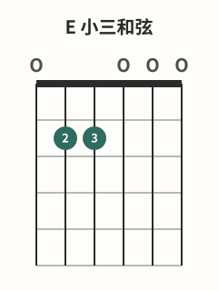

# C-G-Am-Em和弦进行

## 学习目标与先修知识

先完成 [[02-和弦系统/和弦转换方法|和弦转换方法]]。本页把和弦进行限定为按 `C→G→Am→Em` 顺序循环的原创教学练习，不对应歌曲，不复制歌曲伴奏或扫弦型。

> 安全边界：本页不用于诊断或治疗。出现疼痛、麻木或针刺感、无力、肿胀、动作控制下降或明显不适时，立即停止；症状持续、反复或加重时，请向合格医疗专业人士求助。[^safety-bapam]

## 核心概念

本页的和弦进行就是四个和弦的固定顺序：C、G、Am、Em，然后回到 C。采用的 G 是四指变体 `3-2-0-0-3-3`，不在循环中悄悄换成其他 G 形。转换前提前命名下一形，并让手指移动贴近指板。[^changes-fender]

## 图示与操作步骤

本页所有指法数字均按低音六弦到高音一弦书写；`x` 表示不弹/制音，`0` 表示空弦。

[打开C 大三和弦原图（移动端可放大）](../assets/diagrams/chord-c-major.svg)

C 是 `x-3-2-0-1-0`，从第 5 弦起奏。[^c-fender]

[打开G 大三和弦四指变体原图（移动端可放大）](../assets/diagrams/chord-g-major.svg)

G 是本批采用的四指变体 `3-2-0-0-3-3`，六弦全弹。[^g-fender]

[打开A 小三和弦原图（移动端可放大）](../assets/diagrams/chord-a-minor.svg)

Am 是 `x-0-2-2-1-0`，从第 5 弦起奏。[^am-fender]

[打开E 小三和弦原图（移动端可放大）](../assets/diagrams/chord-e-minor.svg)

Em 是 `0-2-2-0-0-0`，六弦全弹。[^em-fender]

先分别练 C→G、G→Am、Am→Em、Em→C，每对落位后逐弦检查；最后才连成四和弦。只用整和弦的单次脉冲，不引入借用的扫弦节奏。

## 常见错误及修正

- 一次失误就从循环开头全部重来：先在下一个和弦站稳，再继续顺序。
- 忘记 C/Am 从五弦起，G/Em 六弦全弹：落指前先口述起始弦。
- 转换还需猜测就加快：恢复一和弦一停顿，先计划再移动。
- 把四指 G 悄悄换形：重新对照 tuple 和图示指号。

## 分级练习

### 入门｜一和弦一停顿

按顺序组形，每个和弦后停下，说出下一个和弦和起始弦，再移动。

### 巩固｜成对转换

把四对转换分开，一次只观察一对中的抬指、移动和落点；没有真正共享位置就不强造 pivot。

### 挑战｜连续舒适脉冲

用整和弦单次拨奏连续循环，保持舒适且稳定的脉冲。不设固定速度；一旦起始弦或形状开始混乱，退回上一级。

## 自我检查标准

- 顺序始终是 C→G→Am→Em，四个 tuple 与图一致。
- 每个和弦的目标弦可听，C/Am 不把第 6 弦当作目标。
- 失误后可在下一个可控点恢复，不会为追速度忽略计划。

## 下一步与相关词条

下一步进入 [[02-和弦系统/C-Am-F-G和弦进行|C-Am-F-G和弦进行]]。可回查 [[02-和弦系统/和弦转换方法|和弦转换方法]]、[[02-和弦系统/C和弦|C和弦]]、[[02-和弦系统/G和弦|G和弦]]、[[02-和弦系统/Am与A和弦|Am与A和弦]] 与 [[02-和弦系统/Em与E和弦|Em与E和弦]]。

## 参考来源与延伸阅读

指位与转换原则由下列资料支持；进行、成对顺序与分级练习均为原创。

[^c-fender]: [Learn to Play the C Chord on Guitar](https://www.fender.com/articles/chords/learn-how-to-play-c-guitar-chord) — Fender Musical Instruments Corporation；访问日期：2026-10-01。

[^g-fender]: [How to Play the G Chord on Guitar](https://www.fender.com/articles/chords/learn-how-to-play-the-g-major-chord-on-guitar) — Fender Musical Instruments Corporation；访问日期：2026-10-01。

[^am-fender]: [How to Play the A Minor Chord](https://www.fender.com/articles/chords/learn-how-to-play-a-minor-guitar-chord) — Fender Musical Instruments Corporation；访问日期：2026-10-01。

[^em-fender]: [How to Play an Em Guitar Chord](https://www.fender.com/articles/chords/learn-how-to-play-e-minor-chord) — Fender Musical Instruments Corporation；访问日期：2026-10-01。

[^changes-fender]: [5 Tips to Master Chord Changes](https://www.fender.com/articles/chords/5-tips-to-master-chord-changes) — Fender Musical Instruments Corporation；访问日期：2026-10-01。

[^safety-bapam]: [Returning to Playing and Performance for Instrumental Musicians](https://www.bapam.org.uk/return-to-play/) — British Association for Performing Arts Medicine；访问日期：2026-10-01。
