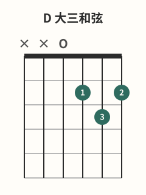
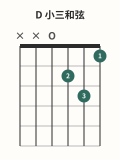

# D与Dm和弦

## 学习目标与先修知识

先完成 [[02-和弦系统/G和弦|G和弦]]。本页要分别组成 D 和 Dm，两者都从第 4 弦起奏，并用第 1 弦的 F#/F 差异做核对。

> 安全边界：本页不用于诊断或治疗。出现疼痛、麻木或针刺感、无力、肿胀、动作控制下降或明显不适时，立即停止；症状持续、反复或加重时，请向合格医疗专业人士求助。[^safety-bapam]

## 核心概念

D 是 `x-x-0-2-3-2`，Dm 是 `x-x-0-2-3-1`；都将第 6、5 弦排除，从第 4 弦空弦开始。[^d-fender][^dm-fender] 两者的第 1 弦分别是 2 品 F# 和 1 品 F，这是本页最容易检查的差异。

## 图示与操作步骤

本页所有指法数字均按低音六弦到高音一弦书写；`x` 表示不弹/制音，`0` 表示空弦。

[打开D 大三和弦原图（移动端可放大）](../assets/diagrams/chord-d-major.svg)

D `x-x-0-2-3-2`：第 3 弦2 品用 1 指，第 2 弦3 品用 3 指，第 1 弦2 品用 2 指。[^d-fender]

[打开D 小三和弦原图（移动端可放大）](../assets/diagrams/chord-d-minor.svg)

Dm `x-x-0-2-3-1`：第 3 弦2 品用 2 指，第 2 弦3 品用 3 指，第 1 弦1 品用 1 指。[^dm-fender] 两形都先找第 4 弦起点，再从 4 到 1 逐弦检查。

## 常见错误及修正

- 把 `x-x-0-2-3-0` 称为“简化 Dm”：该形是 Dsus2，不是本页 Dm；回到第 1 弦1 品。
- 把第 6、5 弦作为目标一起扫：先用拨片轻触第 4 弦定位。
- 从 D 复制手型到 Dm 却不检查第 1 弦：每次转换后先单独拨第 1 弦。
- 不清晰就猛加压：先靠近品丝、排查相邻弦接触，然后用最小有效压力。[^fretting-fender][^dynamics-fender]

## 分级练习

### 入门｜独立组形

分别建立 D 和 Dm，每次都口述“六、五不弹，四弦开始”，然后听四根目标弦。

### 巩固｜一音对照

分别按出 D 和 Dm 后，先单独听第 1 弦的 F#/F，再听完整和弦，不以情绪形容取代音高检查。

### 挑战｜原创 D↔Dm 循环

完成 `D→Dm→D→Dm`，每个和弦只用一次整体拨奏。先保留停顿检查，准确后再用舒适稳定脉冲。

## 自我检查标准

- D 和 Dm 都从第 4 弦起奏，四根目标弦可分别听见。
- 你能说出 D 的第 1 弦是 2 品，Dm 的第 1 弦是 1 品。
- 你不会把第 1 弦空弦形误认为 Dm。

## 下一步与相关词条

按清单个和弦后，下一步学习 [[02-和弦系统/常用七和弦|常用七和弦]]。可回查 [[02-和弦系统/G和弦|G和弦]]，或进入同一分支下的 [[02-和弦系统/和弦转换方法|和弦转换方法]]。

## 参考来源与延伸阅读

D/Dm 指位与按弦原则依据下列资料；循环为原创。

[^d-fender]: [How to Play the D Chord on Guitar](https://www.fender.com/articles/chords/learn-how-to-play-the-d-chord-on-guitar) — Fender Musical Instruments Corporation；访问日期：2026-10-01。

[^dm-fender]: [How to Play the D Minor Guitar Chord](https://www.fender.com/articles/chords/learn-how-to-play-dm-guitar-chord) — Fender Musical Instruments Corporation；访问日期：2026-10-01。

[^fretting-fender]: [5 Ways to Cut the Buzz](https://www.fender.com/articles/techniques/5-ways-to-stop-fret-buzz) — Fender Musical Instruments Corporation；访问日期：2026-10-01。

[^dynamics-fender]: [How to Use Dynamics to Improve Your Guitar Playing](https://www.fender.com/articles/techniques/how-to-use-dynamics-to-improve-guitar-playing) — Fender Musical Instruments Corporation；访问日期：2026-10-01。

[^safety-bapam]: [Returning to Playing and Performance for Instrumental Musicians](https://www.bapam.org.uk/return-to-play/) — British Association for Performing Arts Medicine；访问日期：2026-10-01。
