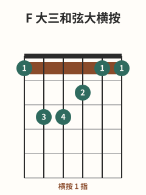

# F大横按与移动和弦

## 学习目标与先修知识

先完成 [[02-和弦系统/F简化指法与横按准备|F简化指法与横按准备]]，并只在无症状时继续。本页对照简化 F 与完整 F，介绍六弦根音形移动后和弦名会随根音改变的基本逻辑，不发布全指板查表。

> 本页只提供一般性练习与安全信息，不用于诊断或治疗。出现疼痛、麻木或针刺感、无力、肿胀、动作控制下降或明显不适时，立即停止本项练习。症状持续、反复或加重，或已影响日常活动或握持能力时，请向合格医疗专业人士求助；严重疼痛、外伤后失去感觉或无法活动时，按所在地急诊指引及时就医。[^safety-bapam][^safety-nhs-rsi][^safety-nhs-finger]

## 核心概念

简化 F `x-x-3-2-1-1` 从四弦起奏；完整 F `1-3-3-2-1-1` 在本批数据中用 1 指覆盖第 1 品六弦至一弦，其余为第 5 弦3 品 3 指、第 4 弦3 品 4 指、第 3 弦2 品 2 指。[^f-fender]

“可移动”在本页只表示：保持六弦根音的相对形状并移到另一品时，第 6 弦根音改变，和弦名也随根音改变；移后不能都叫 F。一指按多弦与六弦根音可移动形是正式教学主题，但本页不外推为所有横按和全指板地图。[^d-fender][^barre-fender]

## 图示与操作步骤

本页所有指法数字均按六弦到一弦书写；`x` 表示不弹/制音，`0` 表示空弦。

[打开F 大三和弦简化按法原图（移动端可放大）](../assets/diagrams/chord-f-major-simplified.svg)

先重建简化 F `x-x-3-2-1-1`，确认四根目标弦与最小有效压力。

[打开F 大三和弦大横按原图（移动端可放大）](../assets/diagrams/chord-f-major-barre.svg)

完整 F `1-3-3-2-1-1` 的逐弦指号是 1、3、4、2、1、1，六根弦都发声。[^f-fender] 不必一开始就要求六根全清晰：可先轻放 1 指，分组听 6–4 弦与 3–1 弦，再在舒适前提下组合。按弦只需足够稳定的最小压力。[^dynamics-fender]

## 常见错误及修正

- 未检查单根接触就六弦一起猛压：释压，按弦组分开听，然后只增加必要压力。
- 移动时丢失根音命名逻辑：移动前后都指出第 6 弦根音，名称随它变化。
- 把每个移动位置都称为 F：只有根音为 F 时才如此命名。
- 锁死手腕或出现症状后继续：立即停止，不用“六弦必须响”覆盖安全边界。

## 分级练习

### 入门｜分组接触

只轻放横按指，分组观察第 6–4 弦和第 3–1 弦；不要求完整发声，重点是识别接触点和保持无症状。

### 巩固｜舒适时组合完整形

只在舒适时加入 3、4、2 指，由分组逐步合并。某根不响时可记下但不硬撑；症状出现就停止。

### 挑战｜轻放与移位观察

释放压力后保持相对形状，轻轻移到相邻品位，只观察第 6 弦根音和命名为何应改变；不要求每个移动和弦都发声。

## 自我检查标准

- 你能对照说出简化 F `x-x-3-2-1-1` 与完整 F `1-3-3-2-1-1`。
- 你能解释：保持六弦根音形移动后，根音改变使和弦名改变，不是处处都叫 F。
- 六弦全部清晰不是忍痛的通关条件；你会在症状出现时停止，持续、反复或加重时求助。

## 下一步与相关词条

下一个计划页是“节拍拍号与小节”，在节奏批次真实发布前保持纯文字，不建立链接。当前可回到 [[02-和弦系统/F简化指法与横按准备|F简化指法与横按准备]]、[[02-和弦系统/C-Am-F-G和弦进行|C-Am-F-G和弦进行]]、[[01-持琴与基础动作/正确按弦|正确按弦]] 或 [[00-从这里开始/学习路线总览|学习路线总览]]。

## 参考来源与延伸阅读

横按指位、可移动概念、压力与非诊断安全边界依据下列资料；分组练习为原创。

[^f-fender]: [How to Play F Major](https://www.fender.com/articles/chords/learn-how-to-play-f-chord-on-guitar) — Fender Musical Instruments Corporation；访问日期：2026-10-01。

[^d-fender]: [How to Play the D Chord on Guitar](https://www.fender.com/articles/chords/learn-how-to-play-the-d-chord-on-guitar) — Fender Musical Instruments Corporation；访问日期：2026-10-01。

[^barre-fender]: [Barre Chords: E String Root Major & Minor](https://www.fender.com/play/lessons/barre-chords-e-string-root-major-minor) — Fender Musical Instruments Corporation；访问日期：2026-10-01。

[^dynamics-fender]: [How to Use Dynamics to Improve Your Guitar Playing](https://www.fender.com/articles/techniques/how-to-use-dynamics-to-improve-guitar-playing) — Fender Musical Instruments Corporation；访问日期：2026-10-01。

[^safety-bapam]: [Returning to Playing and Performance for Instrumental Musicians](https://www.bapam.org.uk/return-to-play/) — British Association for Performing Arts Medicine；访问日期：2026-10-01。

[^safety-nhs-rsi]: [Repetitive strain injury (RSI)](https://www.nhs.uk/conditions/repetitive-strain-injury-rsi/) — UK National Health Service；访问日期：2026-10-01。

[^safety-nhs-finger]: [Finger pain](https://www.nhs.uk/symptoms/hand-pain/finger-pain/) — UK National Health Service；访问日期：2026-10-01。
