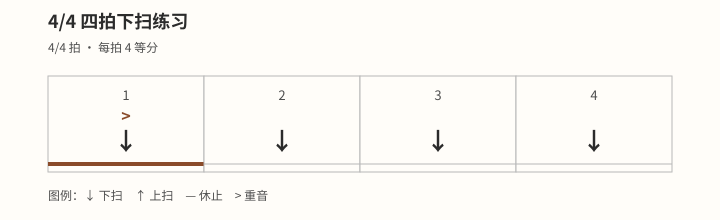

# 四拍全下扫

## 学习目标与先修知识

本页把每个 4/4 四分音符主拍配成一次下扫。完成后，你应能让 `1 2 3 4` 四个落点均匀，并让下一个小节的 `1` 按时返回。请先完成 [[03-节奏系统/04-放松而稳定的扫弦动作|放松而稳定的扫弦动作]]，确认下扫之后能轻松返回准备位置。

第 `1` 拍相对突出是本页原创练习的版本，不是所有 4/4 音乐的普遍重音规则。先学会准确落点，再把相对层次作为可控变化。

## 核心概念

4/4 简单拍每小节有四个四分音符主拍，可用数字 `1 2 3 4` 标出。[^omt-simple] 本页每个数字配一次下扫；下扫之间，手需要平稳返回上方准备下一次动作，而不是静止等点击出现。

节拍器提供稳定点击，把每次下扫落在点击上是一种可用练法。[^metronome-fender] 点击只帮助观察位置；舒适稳定的脉冲优先于追求某个速度。

“重音”在这里表示第 `1` 拍比其他拍相对明显，并不要求最大力量。拨弦手改变触弦层次，按弦手仍维持稳定、够用的压力。

## 图示与操作步骤

下面是本站原创练习的完整文字编码；即使不看图片，也能读出口数、动作与重音。

```text
口数  1  2  3  4
动作  ↓  ↓  ↓  ↓
重音  >  ·  ·  ·
```



[打开〈4/4 四拍全下扫〉原图（移动端可放大）](../assets/diagrams/rhythm-four-downstrokes.svg)

1. 先只说 `1 2 3 4`，在想象的小节线后回到下一次 `1`。
2. 按弦手轻触琴弦制音，拨弦手在每个数字下扫；每次下扫后自然返回。
3. 换成一个熟悉且发声清楚的和弦，先保持四个落点一样轻。
4. 再让第 `1` 拍相对突出，确认 `2 3 4` 仍清楚，不因对比而消失。
5. 连接两个小节。必要时可先在小节之间做一次安静重置，再尝试无缝连续。

## 常见错误及修正

- **等点击出现才启动：** 手会迟到。让返回动作提前完成，听到点击时只发生下扫落点。
- **把第 `3`、`4` 拍挤在一起：** 持续说出口数，特别检查 `4` 到下一个 `1` 的间隔。
- **漏拍后匆忙补一下：** 不追加额外下扫；保留当前位置，下一小节从清楚的 `1` 重进。
- **用按弦手夹紧制造重音：** 按弦压力保持够用且稳定，层次由拨弦手控制。

## 分级练习

以下练习均为本站原创练习，从舒适稳定的脉冲开始。

### 一级：口数与拍手

连续数两个小节，并在每个数字拍手。第二个 `1` 应与之前的拍距相同，不多出停顿。

### 二级：静音下扫

把拍手换成静音下扫。请同伴只听动作，判断是否始终是四次而非漏拍后多补一次。

### 三级：单和弦循环

用一个熟悉和弦扫两个小节，再加入第 `1` 拍相对重音。若重音使拍距改变，就先恢复均匀音量。

> 安全边界：本页不用于诊断或治疗。出现疼痛、麻木或针刺感、无力、肿胀、动作控制下降或明显不适时，立即停止；症状持续、反复或加重时，请向合格医疗专业人士求助。

不适、疲劳或控制下降时停止练习并减少要求，不以更大力量修正落点。[^safety-bapam]

## 自我检查标准

- 四次下扫能分别对应 `1 2 3 4`，没有多扫、漏扫或事后补扫。
- 从 `4` 到下一个 `1` 的间隔与其他相邻主拍一致。
- 旁听者能听出第 `1` 拍相对突出，但四拍位置没有因此移动。
- 你能先做一次安静重置，再逐步连接两个小节，而不是勉强维持失控动作。

## 下一步与相关词条

下一步在每拍加入两个位置，学习 [[03-节奏系统/06-基础八分音符扫弦|基础八分音符扫弦]]。外部脉冲可回看 [[03-节奏系统/02-第一次使用节拍器|第一次使用节拍器]]，动作路径可回看 [[03-节奏系统/04-放松而稳定的扫弦动作|放松而稳定的扫弦动作]]。

## 参考来源与延伸阅读

- 4/4 的主拍组织与数字口数见 Open Music Theory。[^omt-simple]
- 点击与下扫对齐的练习原则见 Fender。[^metronome-fender]
- 一般停止练习与求助边界见 BAPAM。[^safety-bapam]

[^omt-simple]: [Simple Meter and Time Signatures](https://viva.pressbooks.pub/openmusictheory/chapter/simple-meter-and-time-signatures/) — Mark Gotham、Chelsey Hamm、Kris Shaffer，Open Music Theory；访问日期：2026-10-01。

[^metronome-fender]: [How to Improve Your Timing with a Metronome](https://www.fender.com/articles/techniques/how-to-improve-your-timing-with-a-metronome) — Fender Musical Instruments Corporation；访问日期：2026-10-01。

[^safety-bapam]: [Returning to Playing and Performance for Instrumental Musicians](https://www.bapam.org.uk/return-to-play/) — British Association for Performing Arts Medicine；访问日期：2026-10-01。
