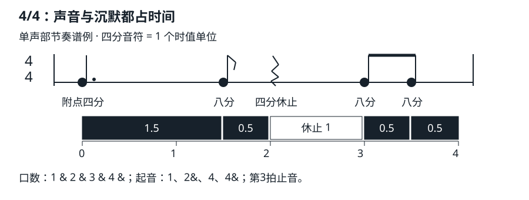

# 休止附点与延音线

## 学习目标与先修知识

“手没有再拨弦”可以是让音继续，也可以是让声音停止；谱面必须分清这两种情况。读完本页，你应能计算附点时值、分辨延音线与连音线，标出一个短节奏的起音和静默位置。先读 [[03-节奏系统/四分八分与十六分音符|四分八分与十六分音符]]，能以四分为 1 换算八分和十六分。

## 核心概念

### 休止是有长度的沉默

四分休止和四分音符占用相同时间，但前者不应有该声部的持续音。吉他只停止拨弦可能仍有余音；需要用轻触制音让该声部在休止开始处结束。多声部谱里，一个声部休止不一定要求所有弦都沉默；本页先练单音声部。[^values]

### 附点是相加，不是随意拖长

一个附点增加原音值的一半：附点四分为 `1+1/2=1.5`，附点八分为 `1/2+1/4=0.75` 个四分单位。两个附点依次增加原值的一半、四分之一：双附点四分为 `1+1/2+1/4=1.75`，不是 `1+1/2+1/2`。附点也可用于休止；是否这样写要兼顾拍点清晰。[^values]

在 4/4 中，附点四分从第 1 拍开始，占据 `1 & 2` 三个八分格；下一个八分从 `2&` 起音。在 6/8 中同样长的附点四分恰好占一个正常主拍。音值不变，所处的拍层级不同。

### 延音线、连音线与连音比例

延音线（tie）连接相邻的同一音高，把时值相加，只在第一音起音。连音线（slur）表示一组音连贯处理，不把不同音高合成一音，也不改变所写时值；吉他具体用击弦、勾弦还是连贯拨奏须看指法与演奏语境。标数字 3 的三连音则改变分割比例，是 [[03-节奏系统/连音与节奏分组|连音与节奏分组]] 的主题；三者不能只因“有弧线／连”就混为一谈。[^values][^ties-slurs]

例如第一小节第 4 拍的四分 C4 延到下一小节第 1 拍的四分 C4，总共持续两拍；小节线与下一小节的拍点仍然存在，但那里不重新拨弦。为了让本课不依赖音高先修，C4、D4 在此只表示两个不同音高：同名同音区才是这里的同音。

## 图示与操作步骤

### 四四拍事件核对

下面是本站原创单小节。时间从 0 开始，以四分为 1；“起音数”只计算有声音符，不计算休止。最后结束在 4，恰好接下一小节。

| 事件         | 起点 | 时值 | 起音数 |
| ------------ | ---- | ---- | ------ |
| 附点四分音符 | 0    | 1.5  | 1      |
| 八分音符     | 1.5  | 0.5  | 1      |
| 四分休止     | 2    | 1    | 0      |
| 八分音符     | 3    | 0.5  | 1      |
| 八分音符     | 3.5  | 0.5  | 1      |

1. 先说 `1 & 2 & 3 & 4 &`，数字拍保持等距。
2. 在 `1` 起音并保持到 `2&`；在 `2&` 再起音，到第 3 拍停止。
3. 第 3 拍及它的 `&` 保持沉默；第 4 拍和 `4&` 各起音一次。
4. 用单根空弦或哼唱完成；不需要和弦转换。空弦版在第 3 拍轻触止音，不要把止音做成额外的强打击。
5. 核算 `1.5+0.5+1+0.5+0.5=4`；起音只有四次，不能把表的五行误数成五次发声。

### 延音与重奏核对

| 写法               | 总时值（四分为1） | 起音数 |
| ------------------ | ----------------- | ------ |
| C4四分延音至C4四分 | 2                 | 1      |
| C4四分后重奏C4四分 | 2                 | 2      |
| C4四分连奏至D4四分 | 2                 | 2      |

最后一行有两个音高事件；连贯不代表只存在第一个音。这里“起音”指新音高事件的开始，不要求每次都用拨片重新拨弦。

## 常见错误及修正

- 在延音线后再次拨同音：先在谱上圈出唯一的起音，后续音符只计持续时间。
- 把附点理解为“多半拍”：只有原值恰为一拍时才多半拍。附点八分在四分主拍里只增加四分之一拍。
- 在休止处仍让空弦响：录下单音练习，检查休止边界是否真有静默；本页没有提供或代替你的实际听辨结果。
- 把连音线当作时值缩放：音符长度只有明确的连音比例等记号才改变；普通连奏线不改变总和。

## 分级练习

### 一级：辨认

R1. 两个四分 C4 用延音线相连，与两个四分 C4 分开演奏，在总时值与起音数上分别有什么关系？

R2. 四分休止和“让前一个音继续一拍”能否互换？

### 二级：推导

D1. 以四分为 1，计算附点二分、附点八分、双附点四分。各补多少时值才能与一个全音符合计相同？

D2. 4/4 的第 4 拍起一个八分 C4，用延音线接 `4&` 的八分 C4，再延到下一小节第 1 拍的四分 C4。总时值、起音数、结束位置是什么？

### 三级：应用

A1. 把“图示与操作步骤”的单小节连续演两遍，然后将第 3 拍休止改为延续前音。说明第二版必须怎样改写谱面，为什么它不再等同于原版？

### 答案与解析

- R1：都是 `1+1=2`；延音只一次起音，分开重奏两次。因此长度相同不等于节奏发声事件相同。
- R2：不能。前者该声部沉默，后者仍发声；不再拨弦不是休止的充分条件。
- D1：附点二分 `2+1=3`，补 1；附点八分 `0.5+0.25=0.75`，补 3.25；双附点四分 `1+0.5+0.25=1.75`，补 2.25。补足的数值可由多个音符或休止组成，书写还要显示拍点。
- D2：`0.5+0.5+1=2`，只有一次起音；从本小节第 4 拍延到下小节第 2 拍开始处结束。跨过小节线不会增加一次起音。
- A1：一种写法是把 `2&` 的八分与第 3 拍的同音四分用延音线连接。总小节长仍为 4，但第 3 拍现在有延续音，原来的静默被取消。评价看是否保留八分格位置、是否清楚表达持续／静默区别，而不是只看拍数相加是否正确。

## 自我检查标准

能分别数清“符号数、起音数、总时值”；能在第 3 拍准确止音；能说明跨小节延音处有拍点却无重新起音。如果总和算错，回到先修的时值比例；如果声音事件错，先用哼唱分开练持续与休止，不增加动作负担。

实际演奏出现疼痛、麻木或控制下降时停止，安全入口见 [[08-保养安全与排错/疼痛疲劳与停止练习边界|疼痛疲劳与停止练习边界]]；本页不是医疗建议。

## 下一步与相关词条

到 [[03-节奏系统/连音与节奏分组|连音与节奏分组]] 区分正常三分与三连音；到 [[03-节奏系统/切分节奏入门|切分节奏入门]] 观察弱位起音如何跨过强位。复查节拍层级可读 [[03-节奏系统/节拍拍号与小节|节拍拍号与小节]]。

## 参考来源与延伸阅读

基础符号定义见以下教材；事件表、换算题和图示均由本站原创，正文已包含解题需要的全部信息。

[^values]: [Rhythmic values](https://open-musictheory.github.io/docs/fundamentals/rhythmic-values/) — Open Music Theory 编写组；访问日期：2026-10-02。支持休止、附点及同音延音的定义。

[^ties-slurs]: [Dots and Ties](https://musictheory.pugetsound.edu/mt21c/DotsAndTies.html) — Robert Hutchinson，Music Theory for the 21st-Century Classroom，University of Puget Sound；访问日期：2026-10-02。用于延音线和连音线区别。
