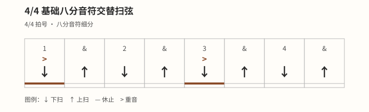

# 重音与强弱层次

## 学习目标与先修知识

本页在同一个八分网格上比较均匀、第 `1` 拍突出和第 `1`、`3` 拍突出三种版本。请先完成 [[03-节奏系统/基础八分音符扫弦|基础八分音符扫弦]]，确保八个位置均匀，再改变相对音量。

完成后，你应能让旁听者辨认计划中的突出格，同时不移动任何格的位置。重音的目的在于形成层次，不在于证明力量大小。

## 核心概念

重音是某个声音相对周围声音更突出；dynamics 指响度的变化。拨弦手改变触弦可以形成音量层次，而按弦手只需保持稳定、足够的压力，不需要随重音夹得更紧。[^dynamics-fender]

重音是相对突出，不等于最大力量或最用力的一击。非重音仍应有意、清楚；若为了对比而让其意外消失，练习就不再表达预定版本。

拍具有层级，但具体重量会随拍号、风格和演奏目的改变。[^omt-simple] 所以下面的第 `1` 拍版与第 `1`、`3` 拍版都是本站原创练习映射，不是所有 4/4 风格的固定规则。

## 图示与操作步骤

三种本站原创练习共用相同口数和动作，只改变“重音”一行。

### 均匀版

```text
口数  1  &  2  &  3  &  4  &
动作  ↓  ↑  ↓  ↑  ↓  ↑  ↓  ↑
重音  ·  ·  ·  ·  ·  ·  ·  ·
```

### 第 1 拍相对突出版

```text
口数  1  &  2  &  3  &  4  &
动作  ↓  ↑  ↓  ↑  ↓  ↑  ↓  ↑
重音  >  ·  ·  ·  ·  ·  ·  ·
```

### 图示第 1、3 拍相对突出版

```text
口数  1  &  2  &  3  &  4  &
动作  ↓  ↑  ↓  ↑  ↓  ↑  ↓  ↑
重音  >  ·  ·  ·  >  ·  ·  ·
```



[打开〈4/4 基础八分音符扫弦〉原图（移动端可放大）](../assets/diagrams/rhythm-basic-eighth-strum.svg)

先拍手完成均匀版，再只让目标格稍明显。转到静音扫弦时保持所有八格触弦，并让拨弦手改变相对层次。最后录下两个版本，随机播放给同伴辨认；若位置随音量移动，先缩小音量差。

## 常见错误及修正

- **音量一变，时间也变：** 重音前不提前蓄力、重音后不延迟；口数保持等距。
- **两只手一起夹紧：** 按弦手维持清楚发声所需的稳定压力，拨弦手负责层次。
- **非重音意外听不见：** 先让全部动作清楚，再做小幅相对差异。
- **把 `1/3` 或 `2/4` 称为普遍规则：** 每次说明当前练习版本；不同拍号与音乐语境可有不同重量分布。

## 分级练习

### 一级：拍手层次

这是本站原创练习。连续拍同一八分网格，轮流做均匀版与第 `1` 拍版；同伴只凭听觉指出版本。

### 二级：静音扫弦对比

在静音弦上交替做第 `1` 拍版和第 `1`、`3` 拍版。每次换版只改目标格，不改动作方向或口数。

### 三级：录音盲辨

录下两个版本，打乱顺序后不看画面回听。若无法辨认，先增加相对差异；若节拍摇晃，则减小差异并恢复均匀版。

> 安全边界：本页不用于诊断或治疗。出现疼痛、麻木或针刺感、无力、肿胀、动作控制下降或明显不适时，立即停止；症状持续、反复或加重时，请向合格医疗专业人士求助。

不适、疲劳或控制下降时停止，不用更紧的握持或更大的冲击追求重音。[^safety-bapam]

## 自我检查标准

- 不看表格的旁听者能指出你计划的突出格。
- 八个位置在均匀版与重音版之间保持等距，下一小节的 `1` 没有延迟。
- 非重音仍然清楚可闻，重音也没有造成拨片卡弦。
- 你能解释图中的第 `1`、`3` 拍只是练习映射，而非普遍风格规则。

## 下一步与相关词条

下一步学习 [[03-节奏系统/切分节奏入门|切分节奏入门]]，把声音放到弱位或拍间。需要恢复均匀动作时，返回 [[03-节奏系统/基础八分音符扫弦|基础八分音符扫弦]]。

## 参考来源与延伸阅读

- 拍的层级与重音会随语境变化，见 Open Music Theory。[^omt-simple]
- dynamics、触弦音量及按弦手稳定压力，见 Fender。[^dynamics-fender]
- 一般停止练习与求助边界见 BAPAM。[^safety-bapam]

[^omt-simple]: [Simple Meter and Time Signatures](https://viva.pressbooks.pub/openmusictheory/chapter/simple-meter-and-time-signatures/) — Mark Gotham、Chelsey Hamm、Kris Shaffer，Open Music Theory；访问日期：2026-10-01。

[^dynamics-fender]: [How to Use Dynamics to Improve Your Guitar Playing](https://www.fender.com/articles/techniques/how-to-use-dynamics-to-improve-guitar-playing) — Fender Musical Instruments Corporation；访问日期：2026-10-01。

[^safety-bapam]: [Returning to Playing and Performance for Instrumental Musicians](https://www.bapam.org.uk/return-to-play/) — British Association for Performing Arts Medicine；访问日期：2026-10-01。
