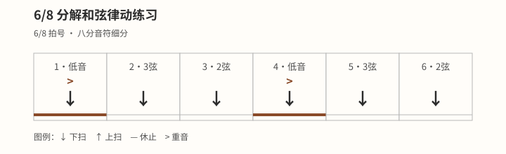

# 常用分解和弦型

## 学习目标与先修知识

请先完成 [[04-演奏技巧/01-分解和弦基础|分解和弦基础]]，能让不同和弦音依次发声。本页用两个 4/4 型与一个 6/8 型，把同一拨弦手分工迁移到 C、G 两个和弦。

这里的“常用”只表示本站课程选取的可复用弦序，不代表受欢迎度统计，也不表示其他弦序不正确。

## 核心概念

分解和弦的核心仍是让和弦音依次出现；改变弦序会改变声音走向，却不改变当前和弦的身份。[^arpeggio-fender] 拇指可以负责低音、其他手指负责较高音弦，但具体分工与弦序要根据和弦允许发声的弦调整。[^travis-fender]

4/4 型采用 `1 & 2 & 3 & 4 &` 八个位置；6/8 型采用 `1 2 3 | 4 5 6` 两个三格组。图示只帮助观察 6/8 分组与组首重音，不能替代表中的琴弦和手指信息。

## 图示与操作步骤

下表全部是本站原创练习，不复制来源 TAB、歌曲或外部练习。竖线只标出 6/8 的分组，不另占时间。

| 型    | 口数              | 琴弦              | 拨弦手                      |
| ----- | ----------------- | ----------------- | --------------------------- |
| 4/4 C | `1 & 2 & 3 & 4 &` | `5 3 2 1 2 3 2 3` | `拇 食 中 无名 中 食 中 食` |
| 4/4 G | `1 & 2 & 3 & 4 &` | `6 3 2 1 2 3 2 3` | `拇 食 中 无名 中 食 中 食` |
| 6/8 C | `1 2 3 \| 4 5 6`  | `5 3 2 \| 4 3 2`  | `拇 食 中 \| 拇 食 中`      |

[打开〈6/8 分解式伴奏脉冲〉原图（移动端可放大）](../assets/diagrams/rhythm-six-eight-arpeggio-pulse.svg)

先用 C 和弦逐格完成 4/4 型，再把低音改为 G 和弦允许发声的第六弦。进入 6/8 时，说清两个三格组，并让两个拇指低音分别落在组首；若图与表不能同时读取，以可见表格为完整动作依据。

图外可见信息再次写全：6/8 C 的口数是 `1 2 3 | 4 5 6`，弦序是 `5 3 2 | 4 3 2`，手指序是 `拇 食 中 | 拇 食 中`。

## 常见错误及修正

- **换成 G 后仍从第五弦开始：** 每次换和弦先读低音弦；本页 G 型从第六弦开始。
- **把 6/8 数成六个主拍：** 保留六格等距，但只把 `1`、`4` 视为两个组首。
- **为了保留延音而让手指停在弦上：** 拨过琴弦后离开振动路径，让前音自然延续。
- **把某一弦序当成普遍规则：** 准确称它为本站练习型，并说明可以为其他音乐目的重新编排。

## 分级练习

### 一级：分别读表

不开节拍器，逐行说出口数、弦号和手指，再用单和弦完成；每次只处理一个型，先确认所有目标弦。

### 二级：舒适脉冲与换形

使用自己能稳定维持的舒适脉冲并开口数拍，比较 4/4 C、4/4 G 与 6/8 C；换型只发生在新小节起点。

### 三级：学习者自选目标脉冲

只有当音色、拍点和放松动作都稳定时，才进入学习者自选的目标脉冲；任一项退化就退回前一阶，先恢复单和弦或单一型。

> 安全边界：本页不用于诊断或治疗。出现疼痛、麻木或针刺感、无力、肿胀、动作控制下降或明显不适时，立即停止；症状持续、反复或加重时，请向合格医疗专业人士求助。

不适或控制下降时暂停，不为维持型而增加夹弦或拨弦力量。[^safety-bapam]

## 自我检查标准

- 三行练习的口数、弦序和手指逐项对应，没有漏格或临时换弦。
- C 型从第五弦开始，G 型从第六弦开始；其余高音弦顺序一致。
- 6/8 能听出 `1-2-3 | 4-5-6` 两组，图示并非唯一信息来源。
- 前一音不会被后一指无意碰停；若发生，你能指出具体弦位。

## 下一步与相关词条

下一步学习 [[04-演奏技巧/03-交替低音|交替低音]]。可回看 [[04-演奏技巧/01-分解和弦基础|分解和弦基础]]、[[03-节奏系统/09-六八拍伴奏|六八拍伴奏]]、[[02-和弦系统/04-C和弦|C和弦]] 与 [[02-和弦系统/05-G和弦|G和弦]]。

## 参考来源与延伸阅读

- 分解和弦的依次发声与拨弦方式见 Fender。[^arpeggio-fender]
- 拇指低音与较高音手指分工的宽泛概念见 Fender；本站弦序不复制其 TAB。[^travis-fender]
- 一般停止练习与求助边界见 BAPAM。[^safety-bapam]

[^arpeggio-fender]: [Everything You Need to Know About Arpeggios](https://www.fender.com/articles/scales/playing-arpeggios-everything-you-need-to-know) — Fender Musical Instruments Corporation；访问日期：2026-10-01。

[^travis-fender]: [Learn the Travis Picking Guitar Technique](https://www.fender.com/articles/techniques/travis-picking-on-guitar) — Fender Musical Instruments Corporation；访问日期：2026-10-01。

[^safety-bapam]: [Returning to Playing and Performance for Instrumental Musicians](https://www.bapam.org.uk/return-to-play/) — British Association for Performing Arts Medicine；访问日期：2026-10-01。
