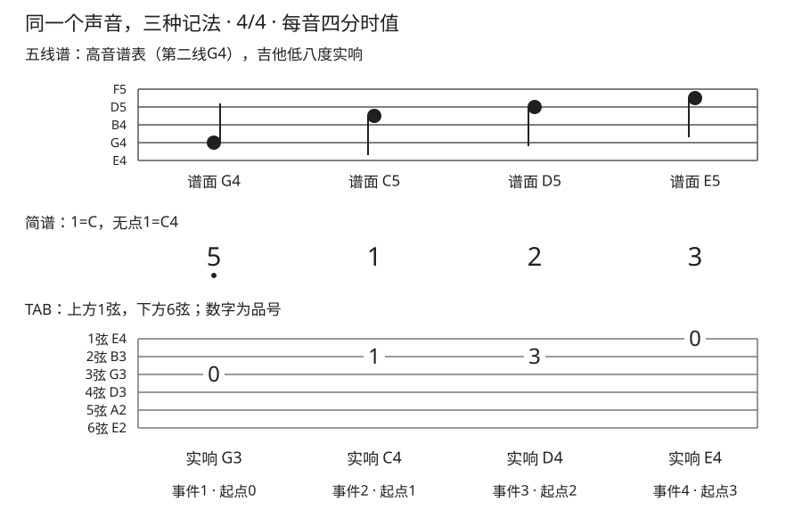

# 五线谱简谱与六线谱

## 学习目标与先修知识

同一段音乐可以写成三套记号，但三套记号回答的问题不同。先读 [[06-基础乐理与指板/01-音高音名与唱名|音高音名与唱名]] 与 [[03-节奏系统/03-四分八分与十六分音符|音符时值]]。本页只要求读懂一个原创短句，并能检查调标、音区、弦品和节奏，不要求会视奏整首作品。

## 核心概念

### 五线谱：纵向读音高，符号读时值

五条线与线间的位置由下往上编号，线和间交替走相邻字母。高音谱号又称G谱号，把第二线确定为G4；五条线自下而上是 E4 G4 B4 D5 F5，四个间是 F4 A4 C5 E5。超出范围用短加线，不是把谱表顶部或底部当成不能越过的边界。[^notation]

阅读顺序是谱号→调号／临时记号→符头位置→时值→必要的八度移位。时值看空实符头、符干、符尾／杠和附点；水平方向表示事件次序，但**不能拿版面毫米间距计算秒数**。临时升降记号通常作用于同小节后续同一音高位置，下一小节恢复调号规则；跨小节的延音保留被延续的音，后面重新起音再按新小节规则判断。不同声部或现代特殊记谱须查看说明，不能猜。[^accidentals]

### 吉他谱面比实响高八度

常规吉他五线谱采用高音谱号并按低八度实响理解：谱面E5对应第一弦空弦E4，谱面G4对应第三弦空弦G3。[^guitar-octave] 部分谱号下方会标小“8”，有的吉他谱省略这一小数字而沿用惯例。本课程事件表明确同时写“谱面／实响”，避免与钢琴或非移调旋律谱混淆。不能见到任意高音谱号就自动降八度；要先确认这是吉他声部及其约定。

### 简谱：数字须连同调标和音区读

数字1–7表示相对音级，常用大调语境唱do re mi fa sol la ti；0表示休止。数字上方／下方加点分别提高／降低八度；数字右侧的附点延长时值，与上下音区点不是一件事。[^jianpu] 本例明确约定 `1=C`、无点1的实响为C4，因而无点5为G4，**下点5**才是G3。仅写 `1=C` 仍应结合谱例／乐器音区说明，不要把数字1一律等同固定弦品。

本例4/4中无下划线的数字各是四分音符，减时线（一条／两条下划线）对应八分／十六分，右侧延长线每条延续一个四分时值。休止的延长通常连续写0，不照抄音符后的横线。[^jianpu-duration] 更复杂的节奏仍要读拍号、附点与连音比例；小调简谱的主音常写6，和分析级数的i不是同一记号，后面 [[06-基础乐理与指板/11-小调音阶|小调音阶]] 会区分。

### 六线谱：数字是品，不是音级

TAB上方一线是1弦，下方一线是6弦；线上数字是品号，0为空弦。[^notation] 所以TAB里的“3”可能表示2弦3品D4，简谱里的“3”在本例却表示E4。多根弦在同一纵向位置的数字表示同时起音，不是按从上到下的顺序弹。

TAB若没有独立的节奏符干或配套五线谱，单靠数字间空格不足以可靠读时值。本例额外给每个事件编号和四分时值；已有伴奏六线谱还可能用叉号表达拨弦位置，须读该谱的图例，不能把所有TAB符号强行套成单音品数。

## 图示与操作步骤

### 三谱事件核对

本站原创4/4短句，四个四分音符；标准定弦、无变调夹。起点与时值均以四分为1，时间0对应第一拍。简谱约定无点1=C4；“5下点”表示数字5正下方一个音区点。

| 事件 | 起点 | 时值 | 实响 | 吉他谱面 | 简谱  | TAB位置 |
| ---- | ---- | ---- | ---- | -------- | ----- | ------- |
| 1    | 0    | 1    | G3   | G4       | 5下点 | 3弦0品  |
| 2    | 1    | 1    | C4   | C5       | 1     | 2弦1品  |
| 3    | 2    | 1    | D4   | D5       | 2     | 2弦3品  |
| 4    | 3    | 1    | E4   | E5       | 3     | 1弦0品  |

1. 在五线谱上先定位第二线G4，再读第三间C5、第四线D5、第四间E5；按吉他惯例各降八度，得到实响。
2. 在简谱上先读1=C与本例音区约定：下点5→G3，无点1/2/3→C4/D4/E4；不要再把简谱也机械降八度。
3. TAB先认弦号，再认品：2弦空弦B3，加1品为C4，加3品为D4；1弦空弦就是E4。
4. 三行每列都是同一次起音，四行时值相加为4。先口述并拍手，再逐音弹；若弹奏不便，纸上换算也能检验理解。

### 换成G大调，哪些标记要变

保持相对数字“下点5、1、2、3”，改为 `1=G` 且无点1=G3，实响得到D3、G3、A3、B3。可用4弦0品、3弦0品、3弦2品、2弦0品；吉他谱面为D4、G4、A4、B4。音级顺序与四分节奏保留，实响、TAB位置和五线谱位置改变。这里选择了较低的主音G3，是明确的音区决策；不能只换调标、保留旧TAB，却声称声音已经移调。

## 常见错误及修正

- 把五线谱第五线看成第五弦：五条线是音高位置，六条TAB线才代表弦。
- 谱面与实响只写一个音区：在作业中分两列，先确定是否吉他八度惯例。
- 简谱下点当附点：上下点决定音区，右侧附点决定时值，定位不同、功能不同。
- 把TAB0看成休止：TAB0要弹空弦，简谱0才表示休止；先辨体系再读数字。

## 分级练习

### 一级：辨认

R1. TAB的0、简谱的0、简谱数字正下方的点，分别是什么意思？本例五线谱的E5应弹出E5还是E4？

### 二级：推导

D1. 本例事件2若改在3弦5品演奏，五线谱、简谱和TAB分别需要怎样改？标准3弦空弦为G3。

D2. 按“换成G大调”约定，将简谱“1 2 3 2”各四分写成实响音名、吉他谱面音名和一套TAB。

### 三级：应用

A1. 把本页四音短句抄成纸上三列对照，遮住任一列由其余两列还原。若同伴将第一音写成无点5，却保留3弦0品，指出矛盾及两种可能的修改方向。

### 答案与解析

- R1：分别为空弦、休止、降低八度；本例谱面E5实响E4，因已明确是常规吉他声部。若是钢琴谱，则不能套用这个下降关系。
- D1：G3到C4需5半音，3弦5品仍实响C4；五线谱C5与简谱1不变，TAB改为3弦5品。同音异位只换演奏位置，不一定换音高记谱。
- D2：实响G3 A3 B3 A3；谱面G4 A4 B4 A4；TAB可用3弦0、3弦2、2弦0、3弦2品。每音仍1个四分单位，不靠TAB空格猜节奏。
- A1：在无点1=C4的约定下，无点5为G4，但3弦0品为G3。若要保留原旋律，把简谱5加下点；若要改成高八度G4，应把TAB改为1弦3品，并将吉他谱面改为G5。评价看音区、弦品、节奏三项是否一致，不要求唯一指法。

## 自我检查标准

能用表格复原同一声音而不依赖外部视频；能区分三套数字／线条含义；能解释为什么同音可换TAB却不换实响。音区混乱回到 [[06-基础乐理与指板/01-音高音名与唱名|音区基础]]；节奏混乱回到 [[03-节奏系统/03-四分八分与十六分音符|时值比例]]。演奏出现疼痛、麻木或控制下降时停止，参见 [[08-保养安全与排错/01-疼痛疲劳与停止练习边界|停止练习边界]]。

## 下一步与相关词条

用 [[06-基础乐理与指板/02-指板上的音名|指板上的音名]] 扩展同音异位；读 [[03-节奏系统/10-休止附点与延音线|休止附点与延音线]] 处理持续与沉默；在 [[05-弹唱与伴奏/10-旋律配和弦与非和弦音|旋律配和弦与非和弦音]] 中再把读谱应用于和声分析。

## 参考来源与延伸阅读

下列来源用于三类谱法、吉他八度与临时记号边界；三谱对照短句和练习均为本站原创。

[^notation]: [A Guitarist’s Guide to Reading Sheet Music and Tablature](https://hub.yamaha.com/guitars/g-how-to/a-guitarists-guide-to-reading-sheet-music-and-tablature/) — Robbie Calvo，Yamaha Corporation of America；访问日期：2026-10-02。用于五线谱、TAB弦序与品数。本课原创谱例不取自该文。

[^guitar-octave]: [Element: octave-change](https://usermanuals.musicxml.com/MusicXML/Content/EL-MusicXML-octave-change.htm) — MusicXML Reference，MakeMusic；访问日期：2026-10-02。文档以标准吉他示范谱面高于实响一个八度。

[^accidentals]: [Displaying pitches — Automatic accidentals](https://lilypond.org/doc/v2.24/Documentation/notation/displaying-pitches#automatic-accidentals) — LilyPond Notation Reference，LilyPond Development Team；访问日期：2026-10-02。用于常规临时记号在同小节、同音区的范围及记谱惯例差异。

[^jianpu]: [如何认简谱](https://szsx.suzhou.edu.cn/scientist-401.html) — 苏州市实验小学校教学资料；访问日期：2026-10-02。用于数字音级和上下音区点；本页音区与吉他映射由本站明确约定。

[^jianpu-duration]: [音符的长短（时值）与休止符](https://www.zuoqu.com/index.php?id=1090) — 作曲大师，武汉市风雅软件有限公司；访问日期：2026-10-02。用于简谱减时线、增时线与0休止；不采用该页其他主题的简略表述。
